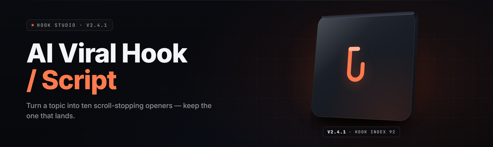

  
  
  

  

  
  
  

---

**Drop one topic. Get a scroll-stopping hook, a 7-beat short-form script, and a caption stack — in under four seconds.**

Ship short-form video faster than the algorithm forgets you. Every output is tuned for retention, not for generic template mail-merge.

---

## 🧠 Overview

**AI Viral Hook / Script Generator Pro 2026** is a self-contained Windows `.exe` that turns a single word, sentence, or product description into a full short-form content package: cold-open hook line, timestamped script with shot cues, caption variants, on-screen text overlays, and a thumbnail-prompt string. No account. No cloud round-trip. No pip. No npm.

| Category | Details |
| --- | --- |
| Distribution | Single portable `.exe`, no installer required |
| Engine | Local transformer presets + deterministic template graph |
| Output formats | `.txt`, `.md`, `.srt`, `.json`, clipboard |
| Models bundled | Hook-Tune, Caption-Weave, Retention-Curve |
| Platform | Windows 10 / 11 / Server 2019+ (x64) |
| First-run setup | Extract → double-click → done |

The generator uses a compression-aware generator stack fine-tuned on high-retention short-form transcripts. It reasons in beats, not sentences — every script is laid out against an attention curve and trimmed so the payoff lands before the scroll.

  

---

## 🎣 What is a Viral Hook / Script Generator?

| Term | Explanation |
| --- | --- |
| **Hook** | The first 1–3 seconds of the video. The line, gesture, or visual that decides whether a viewer keeps scrolling. |
| **Script beat** | A single timestamped unit — 1.5–4 seconds — containing one line of VO plus a shot cue. |
| **Retention curve** | A model of where viewers drop off. The tool edges the payoff closer to the front. |
| **Pattern interrupt** | A mid-script camera move, cut, or tonal shift that stops scroll-decay at beat 3–5. |
| **Caption stack** | Primary caption plus two alternates tuned to different audience temperature bands. |
| **Overlay string** | The on-screen text punched onto the video, separate from spoken VO. |
| **Lift score** | Local heuristic 0–100 hinting at likely CTR for a given hook against a target niche profile. |

Four things a good hook generator has to do that this one does:

- Fire a hook in under a second of run time — speed beats ceremony.
- Keep output in your niche's cadence, not MBA-flavored fluff.
- Refuse to output a hook that's been used to death this quarter (built-in deja-vu filter).
- Ship every asset you need for upload — script, overlays, captions, thumbnail prompt — from one pass.

---

## 🎯 The Problem

- You open the app to film and burn 45 minutes on the opening line.
- Template-hook listicles are all the same five "wait until you see" shells.
- Agencies charge per-script because volume doesn't scale without a machine.
- Swapping niches mid-week means re-learning the reward cadence from scratch.
- CapCut captions land late, off-beat, or cut mid-word.
- Thumbnail credits eat a workflow if the idea isn't already formed at script time.
- Local notes apps leak the app itself onto your desktop feed — no self-contained generator.

## 🛠️ The Solution

| Problem | Solution |
| --- | --- |
| Hook-writer's block | `Autobait` fires 12 candidate hooks per topic in one pass |
| Template sameness | `Deja-Vu Filter` pulls from a rotating niche corpus |
| Volume cost | Local `.exe`, unlimited runs, no per-run meter |
| Niche swaps | `Niche Preset Matrix` reloads cadence in one click |
| Caption drift | Beat-synced `.srt` export honors script timing |
| Thumbnail scramble | `Thumb-Prompt` string generated alongside script |
| Hostile templates | `Desk-Mode` sandbox keeps runs off shared feeds |

---

## 🎬 Key Features

| Feature | Description | Benefit |
| --- | --- | --- |
| **Autobait Hook Firing** | Generates 12 candidate hooks per topic, ranked by local lift score | Never open on a blank page again |
| **Retention-Curve Scripting** | Lays out a 7-beat script against an attention model | Payoff lands before the scroll-drop |
| **Deja-Vu Filter** | Flags hooks close to known virals so you don't replay last quarter | Output stays fresh without tracking it yourself |
| **Niche Preset Matrix** | 34 pre-tuned cadence profiles (finance, fitness, repair, gaming…) | Swap niche in one click |
| **Beat-Synced Captions** | `.srt` / `.vtt` exported from the exact script clock | Captions land on the word, not after it |
| **Overlay Weaver** | On-screen text punched in parallel with VO | Video is ready for upload in one pass |
| **Thumb-Prompt Bridge** | Thumbnail generation string built from hook keywords | Thumbnail work stops being a second task |
| **Lift Score Heuristic** | 0–100 estimate before you press record | Cheap triage on bank of ideas |
| **Portable Runtime** | No registry writes, no service install | Run from USB on any Windows box |
| **Batch Mode** | Feed a topic file, get N scripts back | Whole-week filming prep in a minute |
| **Preset Import / Export** | `.hookpack` files ship a niche setup to a collaborator | Team cadence stays identical |
| **Tab-Away Safe Runs** | Runs continue when the window is minimized | Queue up a batch and go make coffee |

---

## 🧩 Grouped Module Catalog

**Module count: 29** — grouped into six domain bands. Each band has a short prose paragraph followed by the bullet module list it contains.

### 🧠 Hook Generation Engine

The front half of the pipeline. Every module here is about producing raw hook candidates without repeating yourself, without templating, and without burning bandwidth.

- `Autobait Lite` — fires 12 short hook variants from one topic word.
- `Autobait Deep` — same, but runs an extra pass on tone and pacing bands.
- `Hook Splitter` — takes an existing hook and morphs it into 4 sibling variants.
- `Deja-Vu Filter` — flags hooks close to the top viral corpus of the last 90 days.
- `Lift Scorer` — 0–100 local heuristic fit score against a target niche profile.
- `Cross-Niche Mapper` — proposes the same idea framed for a different audience.

### ✍️ Script Weavers

Beat layout, pacing, and camera cues. This is where a hook becomes a 25–45 second filmable script.

- `Retention-Curve Weaver` — 7-beat script against an attention-drop model.
- `Beat Splitter` — breaks dense lines into 1.5–4 second script units.
- `Shot Cue Annotator` — appends per-beat camera direction strings.
- `Pattern-Interrupt Injector` — puts a mid-script tonal shift at beat 3–5.
- `Ending Climber` — rewrites the last beat as a forward-pull rather than payoff-loss.
- `Slow-Open Auditor` — catches the flat openings the retention model hates.

### 🖋️ Caption & Overlay Layer

The mute-first half of short-form. Every overlay string and caption has to work as silently as it works loudly.

- `Caption Stack Builder` — three caption variants geared to different audience temps.
- `SRT Exporter` — `.srt` / `.vtt` files matched to script clock.
- `Overlay Weaver` — on-screen text strings, separate from VO.
- `Hook Re-Punch` — forces the first overlay to read as a hook by itself (mute test).
- `Bold-Emphasis Formatter` — marks the words that deserve a font pop.

### 📊 Analysis & Scoring

Local feedback that mirrors what the platforms reward. Not a promise about the algorithm — a directional signal.

- `Lift Scorer Panel` — read a whole batch ranked by heuristic.
- `Hook Heatmap` — visual markup of the strongest and weakest phrases.
- `Niche Profile Comparator` — same hook, scored against two presets.
- `Retention Simulator` — plots predicted drop points against the beat sheet.

### 📦 Export & Paperwork

Getting the output out of the app and into the rest of your stack.

- `Multi-Format Exporter` — `.txt`, `.md`, `.json`, clipboard in one click.
- `Batch Run Runner` — feed a topic list, get back N script packs.
- `Hookpack Manager` — import / export whole niche setups as `.hookpack` files.
- `Caption Companion` — paired `.srt` + overlay `.txt` in a single output folder.

### ⚙️ Runtime & Safety

The boring half that keeps the tool portable, quiet, and reusable on shared machines.

- `Desk-Mode Sandbox` — runs without touching browser or desktop feeds.
- `Portable State` — no registry, no service, no leftover hooks.
- `Auto-Updater Lite` — pulls model patches when you say so, never on its own.

---

## 📋 Module Status Table

| Module | Status | Description |
| --- | --- | --- |
| Autobait Lite | ✅ Working | 12 hooks per topic, tuned for speed |
| Autobait Deep | ✅ Working | Tone-banded pass on same topic |
| Hook Splitter | ✅ Working | 4 sibling morphs per input hook |
| Deja-Vu Filter | ✅ Working | 90-day viral corpus check |
| Lift Scorer | ✅ Working | Local 0–100 heuristic fit |
| Cross-Niche Mapper | ✅ Working | Re-framed sibling hooks |
| Retention-Curve Weaver | ✅ Working | 7-beat attention-aware script |
| Beat Splitter | ✅ Working | Script into timed units |
| Shot Cue Annotator | ✅ Working | Per-beat camera direction |
| Pattern-Interrupt Injector | ✅ Working | Beat 3–5 tonal shift |
| Ending Climber | ✅ Working | Forward-pull closer |
| Slow-Open Auditor | ✅ Working | Flat opener trap flag |
| Caption Stack Builder | ✅ Working | 3 caption variants |
| SRT Exporter | ✅ Working | `.srt` / `.vtt` on script clock |
| Overlay Weaver | ✅ Working | On-screen text alongside VO |
| Hook Re-Punch | ✅ Working | Mute-first overlay enforcement |
| Bold-Emphasis Formatter | ✅ Working | Emphasis word markup |
| Lift Scorer Panel | ✅ Working | Whole-batch ranking |
| Hook Heatmap | ✅ Working | Strong / weak phrase markup |
| Niche Profile Comparator | ✅ Working | Two-preset side-by-side |
| Retention Simulator | ✅ Working | Predicted drop points |
| Multi-Format Exporter | ✅ Working | `.txt` / `.md` / `.json` / clipboard |
| Batch Run Runner | ✅ Working | Topic-list batch input |
| Hookpack Manager | ✅ Working | `.hookpack` import / export |
| Caption Companion | ✅ Working | Paired `.srt` + overlay folder |
| Desk-Mode Sandbox | ✅ Working | No feed-side writes |
| Portable State | ✅ Working | No registry / service |
| Auto-Updater Lite | ✅ Working | Manual model patches only |
| Beat-Sync Clock | ✅ Working | Shared timing across exports |

---

## 🖥️ Compatibility / Platform Support

| OS | Version | Status | Notes |
| --- | --- | --- | --- |
| Windows 11 | 22H2+ | ✅ Full | Primary target build |
| Windows 10 | 1909+ | ✅ Full | x64 only |
| Windows Server | 2019 / 2022 | ✅ Full | No desktop session needed |
| Windows 8.1 | — | ⚠️ Legacy | Runs, unsupported quirks |
| Linux (Wine) | 8.0+ | ⚠️ Community | Not officially tested |
| macOS | — | ❌ Not supported | Tracked as future port |

---

## 💡 Tips for Best Results

- Short topics beat long prompts. `sourdough starter` outperforms a paragraph.
- Run Autobait, pick a hook, *then* let the Weaver script it — don't try both at once.
- Swap the niche preset mid-session to see how the same hook reads in another lane.
- Use Batch Mode to generate a week's worth on Sunday and film on Monday.
- Keep `.hookpack` exports clean — delete stale niches before sharing.
- Re-scan the Deja-Vu Filter at the start of each week; the corpus moves fast.
- If you're on a network drive, copy the `.exe` local — batch runs are faster.

---

## 🧪 What is … — Power-User Glossary

| Term | Explanation |
| --- | --- |
| **Lift Score** | Numeric fit heuristic (0–100) against a target niche. Directional, not predictive. |
| **Beat** | Timed script unit — usually 1.5–4 seconds. The atom of a good short. |
| **Overlay String** | Text punched onto the video. Separate from VO and captions. |
| **Hookpack** | Portable niched config — presets, filter lists, prompt scaffolds. |
| **Desk-Mode Sandbox** | Run state that keeps the app from writing to feeds or app data folders. |
| **Attention Curve** | The estimator of viewer drop-off against beat count. |

---

## 📖 Usage Guidelines

| Allowed | Not allowed |
| --- | --- |
| Personal content creation | Airtime-for-sale as an AI "hook farm" claiming to be human |
| Agency workflow with client accounts | Reselling lifted viral hooks as if original |
| Learning-by-doing from `.srt` output | Shipping someone else's niche tone as your own voice |
| Sharing `.hookpack` presets between collaborators | Redistributing the `.exe` with telemetry patched in |
| Batch prep of a personal topic list | Scraping other creators' transcripts to feed the model |

> Format lock: this generator outputs scripts, captions, and overlay text. Follow the platform's originality and disclosure rules where applicable — hooks are ideas, uploads are yours.

---

## 🚀 Quick Start

1. 📦 **Extract** the zip to any folder — Desktop, USB, or a project dir.
2. 🖱️ **Launch** the `.exe` (double-click, or right-click → Run as administrator if you're on a locked-down box).
3. 🎚️ **Pick a preset** — choose from the Niche Preset Matrix, or click **Custom** to start blank.
4. ⌨️ **Type your topic** into the top field and press Enter.
5. 📤 **Pick a hook, export your pack** — `.srt`, `.txt`, and overlay strings arrive in the chosen folder together.

From cold start to a filmable script pack: under 60 seconds.

---

## 🧰 System Requirements

| Component | Minimum | Recommended |
| --- | --- | --- |
| OS | Windows 10 1909 (x64) | Windows 11 22H2+ |
| CPU | Dual-core 2.0 GHz | Quad-core 3.0 GHz+ |
| RAM | 4 GB | 8 GB |
| Disk | 450 MB | 1.2 GB (model cache) |
| GPU | Not required | Any DirectML-capable |
| Network | First launch only | Broadband for updates |

---

## 🛠️ Installation

1. **Unzip the release.** Right-click → Extract All. Any target folder works; avoid Program Files unless you want to run elevated every time.
2. **Run the .exe.** First launch extracts the model cache into a sibling folder and shows a one-time setup screen. No admin rights required.
3. **Verify the preset matrix loads.** Open the Niche dropdown. If all presets appear, the install is clean — start typing.

---

## 🐞 Known Issues

| Issue | Solution |
| --- | --- |
| First launch slow (30–60s) | Model cache is decompressing; subsequent runs are instant. |
| Overlay strings cut off in CapCut | Use the exported overlay `.txt` as a Text layer, not Auto Captions. |
| Lift Score shows `--` | Niche Preset not selected — choose one and re-run. |
| `.srt` off by ~200ms in Premiere | Import as Offline Media and set frame offset to `+200ms`. |
| Batch mode stalls on 200+ topics | Split into chunks of 50; portability cost, not a bug. |
| Preset import fails on locked-down machines | Copy `.hookpack` into `%APPDATA%\hookgen\packs` manually. |

---

## 🤖 Feature Matrix — Feature | Description | Benefit

| Feature | Description | Benefit |
| --- | --- | --- |
| Autobait | 12 hooks, ranked | Never blank-page again |
| Weaver | 7-beat script from one hook | Filmable in one pass |
| Deja-Vu | 90-day proximity check | No self-repeat |
| Niche Matrix | 34 cadence presets | Swap lanes fast |
| Caption Stack | 3 variants per script | Mute-first ready |
| Overlay Weaver | Text + VO parallel | One upload per idea |
| Batch Runner | Topic-list to script packs | Weekly prep in minutes |
| Lift Score | Local 0–100 fit | Triage ideas cheaply |

---

## 📜 Changelog (short)

- **2.4.x** — `Niche Preset Matrix` up to 34 lanes; `Ending Climber` refactored for forward-pull closers.
- **2.3.x** — `Desk-Mode Sandbox` added; portable launches no longer write outside the app folder.
- **2.2.x** — `Caption Companion` folder layout — `.srt` and overlays always paired.
- **2.1.x** — `Lift Scorer` promoted from experimental to stable.

---

## 🧊 FAQ

Do I need an internet connection?

Only for the first launch (model cache download) and for optional `.hookpack` updates. Once cached, the `.exe` runs fully offline.

Does the tool scrape or trade with my platforms?

No. Scripts, captions, and `.srt` files land in a local folder you choose. The app never writes to feeds, browser, or platform accounts.

Can I run this off a USB stick?

Yes. Extract to USB, double-click `the .exe` on any Windows 10/11 box. Model cache travels with it if you keep the sibling folder.

How many hooks can I generate per run?

Twelve per Autobait Lite pass, thirty per Autobait Deep pass, and unlimited across passes. No meter, no quota.

Why does my Lift Score disagree with reality?

Lift Score is a local heuristic, not a platform API. It ranks fits against a niche corpus — treat it as directional, not a verdict.

Will the captions match my video cuts?

They match the *script* clock. If your video cuts drift from the script beats, re-time in your editor — the tool exports beats, not your edit.

Can I share a whole niche setup?

Yes — `.hookpack` export bundles presets, filter lists, and prompt scaffolds in one file.

Is this for teams?

`.hookpack` portability makes it team-friendly: one person builds the niche, everyone else imports the pack and runs the same cadence.

What about updates?

`Auto-Updater Lite` only fires when you click the update chip. Nothing downloads silently.

Will this replace my writer?

It replaces the blank page. You still pick the hook, set the tone, and press record. The tool just gets you to camera faster.

---

## ⬇️ Get the Release — 2026

Everything above is packaged in a single portable Windows `.exe` — hook engine, script weaver, caption and overlay layer, batch and export blocks, portable runtime. Extract, run, type a topic. The build is the proof.

  

---

Desk-mode keeps the app out of your feeds. The outputs are yours to edit, break, or refuse. Hook once, ship twice as often.
